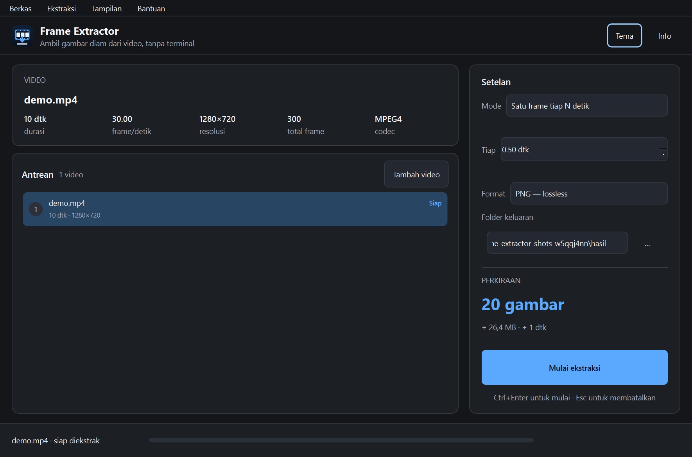
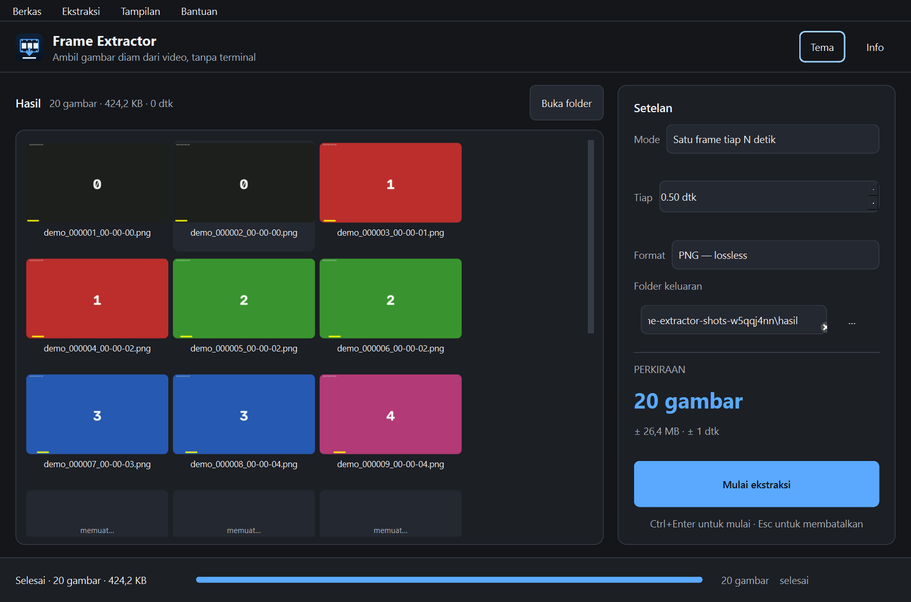

# Frame Extractor

Aplikasi desktop untuk mengambil frame dari video menjadi PNG atau JPG, dengan antrean batch, pratinjau hasil, dan mesin ffmpeg yang bisa dibatalkan — tanpa terminal.



## Unduh

Aset rilis tersedia di halaman **Releases** repositori ini:

| Platform | Berkas | Keterangan |
|---|---|---|
| Windows x64 | `frame-extractor-windows-x64.zip` | Utama (`--onedir`), ffmpeg LGPL disertakan |
| Windows x64 | `frame-extractor-windows-x64-onefile.zip` | Alternatif satu berkas; startup lebih lambat |
| Linux x64 | `frame-extractor-linux-x64.tar.gz` | `--onedir`, ffmpeg LGPL disertakan |
| macOS arm64 | `frame-extractor-macos-arm64.zip` | Aplikasi `.app`; memakai mesin OpenCV |
| Semua | `SHA256SUMS.txt` | Checksum SHA-256 untuk verifikasi unduhan |

Ekstrak arsip, lalu jalankan `Frame Extractor` (Windows: `Frame Extractor.exe`). Tidak perlu memasang Python atau ffmpeg. Biner belum ditandatangani secara digital; Windows SmartScreen dapat meminta konfirmasi. Verifikasi unduhan dengan `SHA256SUMS.txt`.

Status build lokal Windows: `--onedir` 572,9 MiB (ZIP 241,9 MB) dan `--onefile` 229,8 MiB (ZIP 240,2 MB). Linux dan macOS dibangun oleh workflow rilis.

## Pakai dalam tiga langkah

1. **Jatuhkan video atau folder** ke jendela, atau klik **Pilih video**. Beberapa video akan masuk ke antrean.
2. **Atur pengambilan**: satu frame tiap N detik, N frame tersebar merata, atau rentang waktu. Pilih PNG/JPG, kualitas, dan folder keluaran. Perkiraan jumlah gambar langsung diperbarui.
3. **Klik Mulai ekstraksi**. Progres, jumlah frame, dan sisa waktu tampil di bawah; tombol **Batal** (Esc) menghentikan proses tanpa menghapus gambar yang sudah tersimpan. Video yang sudah selesai tetap bertanda **Selesai** dan tidak diekstrak ulang saat Anda menambahkan video baru. Untuk mengeluarkan video dari antrean, pilih barisnya lalu klik **Hapus** atau tekan **Delete**. Setelah selesai, galeri menampilkan thumbnail dan tombol **Buka folder**.




Pintasan: `Ctrl+O` buka video, `Ctrl+Shift+O` tambah ke antrean, `Delete` hapus video terpilih, `Ctrl+Enter` mulai, `Esc` batal, `Ctrl+Q` keluar. Setelan, tema, dan ukuran jendela diingat lewat `QSettings`.

## Format yang didukung

- **Video masukan**: MP4, M4V, MKV, MOV, WebM, AVI, WMV, FLV, MPG/MPEG, MTS/M2TS, TS, 3GP/3G2, OGV/OGG, ASF, VOB, F4V, MXF.
- **Gambar keluaran**: PNG lossless (compression level 6) atau JPG dengan kualitas 1–100.
- **Penamaan**: `{stem}_{index:06d}_{time}.{ext}`, contoh `liburan_000123_00-02-03.png`. Nama yang bentrok tidak pernah menimpa berkas lama; sufiks `-1`, `-2`, dan seterusnya ditambahkan.
- **Mesin**: ffmpeg/ffprobe sebagai subprocess (utama), OpenCV `VideoCapture` sebagai cadangan. Keduanya berjalan di thread pekerja; antarmuka tidak membeku.

## Lisensi

Kode aplikasi: **MIT** — lihat `LICENSE`.

Rilis biner menyertakan Qt for Python/PySide6 (LGPLv3), ffmpeg (LGPL 2.1+), OpenCV (Apache 2.0), NumPy (BSD-3-Clause), dan CPython. Teks lisensi lengkap ada di folder `licenses/`; ringkasan dan tautan sumber ada di `THIRD-PARTY-NOTICES.md`. Aplikasi berjalan tanpa internet dan tidak mengirim telemetri.

## Menjalankan dari sumber

Prasyarat: Python 3.11 atau lebih baru.

```powershell
cd frame-extractor
py -3.12 -m venv .venv
.\.venv\Scripts\Activate.ps1
pip install -e ".[dev]"
python -m frame_extractor
```

Di Linux/macOS, aktifkan venv dengan `source .venv/bin/activate`.

ffmpeg bersifat opsional saat menjalankan dari sumber. Aplikasi mencari ffmpeg/ffprobe di `third_party/ffmpeg/bin`, variabel lingkungan `FRAME_EXTRACTOR_FFMPEG_DIR` / `FRAME_EXTRACTOR_FFMPEG` / `FRAME_EXTRACTOR_FFPROBE`, lalu `PATH`. Bila tidak ditemukan, mesin OpenCV tetap dapat dipakai.

### CLI

```powershell
frame-extractor-cli video.mp4 --mode interval --interval 2 --format png
frame-extractor-cli video.mp4 --count 30 --format jpg --quality 90 --out hasil
frame-extractor-cli video.mp4 --range 5:20 --interval 1 --out potongan
```

Kode keluar: `0` sukses, `1` masukan tidak valid, `2` galat proses, `130` dibatalkan.

### Pengujian

```powershell
.\.venv\Scripts\python.exe -m pytest -q
.\.venv\Scripts\ruff.exe check src tests tools
```

Tes mencakup penamaan, perencanaan titik sampel, probe metadata, ekstraksi ffmpeg/OpenCV, pembatalan, CLI, kontras tema, dan uji asap GUI offscreen.

### Membangun paket rilis

Siapkan ffmpeg LGPL di `third_party/ffmpeg/bin` (Windows: build *shared* BtbN; Linux: build *static* LGPL). Lalu:

```powershell
pyinstaller --noconfirm --clean build/frame_extractor.spec
python build/package.py
```

Hasil `--onedir` ada di `dist/Frame Extractor/`; varian satu berkas dibangun dengan `build/frame_extractor_onefile.spec`. `build/package.py` menyalin lisensi, membuat ZIP/TAR.GZ, dan menulis `SHA256SUMS.txt` di `dist-release/`.
